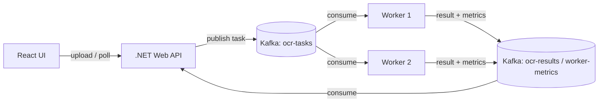

# Distributed OCR System

A distributed image-processing (OCR) pipeline for a course project on distributed systems.

- A **React** frontend lets you upload an image and see the extracted text.
- A **.NET 8** backend orchestrates everything: it accepts uploads, publishes tasks to Kafka, and stores results.
- **Apache Kafka** distributes work to workers via consumer groups (no central dispatcher).
- One or more **Python workers** run on separate machines/containers, each hosting an OCR engine (Tesseract) behind a black-box interface. They pull tasks, process them, and publish results + system metrics back to Kafka.

> 📄 The full architecture, decisions, and roadmap live in [PLAN.md](./PLAN.md). This README is the quick-start guide.

---

## Architecture at a glance



**Key idea:** workers *pull* tasks from Kafka (consumer group `ocr-workers`). They open no inbound ports — they only connect *out* to the broker. Add or remove a worker and Kafka automatically rebalances the load.

---

## Repository layout

```
Distributed-Systems-Project/
├── docker-compose.yml     # Kafka broker (KRaft mode)
├── backend/               # .NET 8 ASP.NET Core Web API (orchestrator)
├── worker/                # Python OCR worker (run on each node/container)
│   ├── main.py            #   Kafka consumer loop (stub)
│   ├── ocr_engine.py      #   black-box OcrEngine interface (stub)
│   ├── metrics.py         #   psutil system-usage reporter
│   ├── config.py          #   topics, broker address, worker id
│   └── requirements.txt
├── frontend/              # React + Vite + TypeScript UI
└── PLAN.md                # full plan & roadmap
```

---

## Prerequisites

Install these once on your machine:

| Tool | Version | Notes |
|------|---------|-------|
| **Docker Desktop** (or Docker Engine) | latest | Runs Kafka |
| **.NET SDK** | 8.0+ | `winget install Microsoft.DotNet.SDK.8` |
| **Node.js** | 18+ | Runs the React frontend (`winget install OpenJS.NodeJS.LTS`) |
| **Python** | 3.10+ | Runs the worker |
| **Tesseract OCR** | 5.x | `winget install UB-Mannheim.TesseractOCR` (Windows) / `apt install tesseract-ocr` (Linux). The Python `pytesseract` wrapper needs the Tesseract *binary* on your PATH. |

Verify:
```powershell
docker --version
dotnet --version
node --version
python --version
tesseract --version
```

---

## 1. Start Kafka

From the repo root:

```powershell
docker compose up -d
```

This starts the broker only. Create the three topics manually (one-time):

```powershell
docker compose exec kafka kafka-topics.sh --bootstrap-server localhost:9092 --create --partitions 1 --replication-factor 1 --topic ocr-tasks
docker compose exec kafka kafka-topics.sh --bootstrap-server localhost:9092 --create --partitions 1 --replication-factor 1 --topic ocr-results
docker compose exec kafka kafka-topics.sh --bootstrap-server localhost:9092 --create --partitions 1 --replication-factor 1 --topic worker-metrics
```

Then confirm they exist:

```powershell
docker compose exec kafka kafka-topics.sh --bootstrap-server localhost:9092 --list
```

You should see:
```
ocr-tasks
ocr-results
worker-metrics
```

Stop Kafka later with `docker compose down` (add `-v` to also delete the data volume).

---

## 2. Run the .NET backend

From the repo root:

```powershell
cd backend
dotnet restore
dotnet run
```

The API listens on a local port (see the console output) with an OpenAPI endpoint at `/openapi/v1.json`.

> **Note:** the backend is currently a *stub* — the default `dotnet new webapi` template. The OCR endpoints (`POST /api/images`, `GET /api/jobs`) are added in Phase 1 of [PLAN.md](./PLAN.md).

---

## 3. Run a Python worker

Set up a virtual environment and install dependencies (do this once):

```powershell
cd worker
python -m venv .venv
.\.venv\Scripts\Activate.ps1        # Windows PowerShell
# source .venv/bin/activate          # Linux / macOS
pip install -r requirements.txt
```

Run a worker:

```powershell
python main.py
```

It connects to Kafka, joins the `ocr-workers` consumer group, and waits for tasks. Point it at a different broker (e.g., over Tailscale) with an env var:

```powershell
$env:KAFKA_BOOTSTRAP_SERVERS = "100.x.y.z:9092"   # the broker's Tailscale IP
$env:WORKER_ID = "worker-1"
python main.py
```

**Run multiple workers** to see load distribution — just start more `python main.py` processes (each with a different `WORKER_ID`), on this machine or separate VMs/containers.

> **Note:** the worker is a *stub skeleton* — the OCR loop is wired but Tesseract must be installed and on PATH for it to actually extract text. Full behavior is completed in Phase 2 of [PLAN.md](./PLAN.md).

---

## 4. Run the React frontend

From the repo root:

```powershell
cd frontend
npm install
npm run dev
```

The Vite dev server opens at `http://localhost:5173`. The UI is currently a *stub* — the upload form and job list are added in Phase 3 of [PLAN.md](./PLAN.md).

---

## Networking for real machines (Tailscale + Cloudflared)

For development everything can run on one machine using `localhost:9092`. To run workers on **separate VMs** and expose the UI publicly, use:

- **Tailscale** — a private mesh network. Install it on every machine (broker host + each worker). Each node gets a stable `100.x.y.z` IP regardless of NAT/ISP. Workers reach Kafka via that IP; no port-forwarding or firewall holes needed.
  ```powershell
  winget install Tailscale.Tailscale   # then sign in with the Tailscale app
  ```
- **Cloudflared** (Cloudflare Tunnel) — exposes the .NET backend + frontend publicly for the live demo without opening inbound ports. The tunnel forwards a public `https://...` URL to your local server.
  ```powershell
  winget install Cloudflare.cloudflared
  cloudflared tunnel --url http://localhost:5000   # quick test tunnel (prints a trycloudflare.com URL)
  ```

Net effect: **zero inbound ports on any machine.** Workers → broker over Tailscale; viewers → UI over the Cloudflare Tunnel.

---

## Troubleshooting

| Symptom | Fix |
|---------|-----|
| `kafka-topics.sh --create` fails with "Not enough replicas" or times out | The broker is still starting up — wait ~15–30 s, then retry the create command. |
| Worker can't reach Kafka on another machine | Make sure both are on the same Tailscale network and you set `KAFKA_BOOTSTRAP_SERVERS` to the broker's **Tailscale IP** (not `localhost`). |
| `pytesseract` raises "Tesseract not found" | The Tesseract *binary* isn't on PATH. Install it (see Prerequisites) and restart your terminal. |
| Backend can't connect to Kafka | Ensure Docker/Kafka is running and `Kafka:BootstrapServers` in `backend/appsettings.json` points at the right host. |
| Frontend can't call the API | CORS origins are configured for `localhost:5173`/`4173`; if you run the UI elsewhere, add that origin in `backend/Program.cs`. |

---

## Next steps

The repo is scaffolded and every component boots. Implementation continues per [PLAN.md](./PLAN.md):

- **Phase 1** — wire up the .NET OCR endpoints (upload → Kafka → result store).
- **Phase 2** — finish the worker OCR loop + metrics publishing.
- **Phase 3** — build the React upload form + live job list.
- **Phase 4** — end-to-end integration, failover & scaling demo.